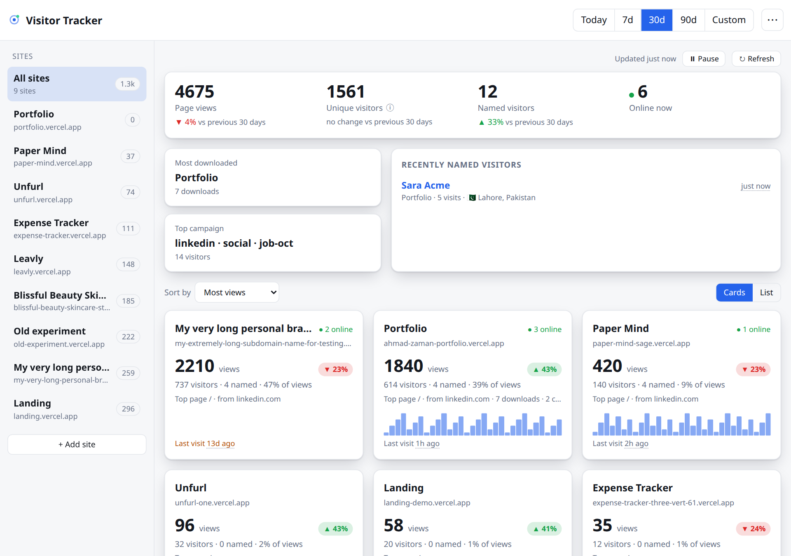
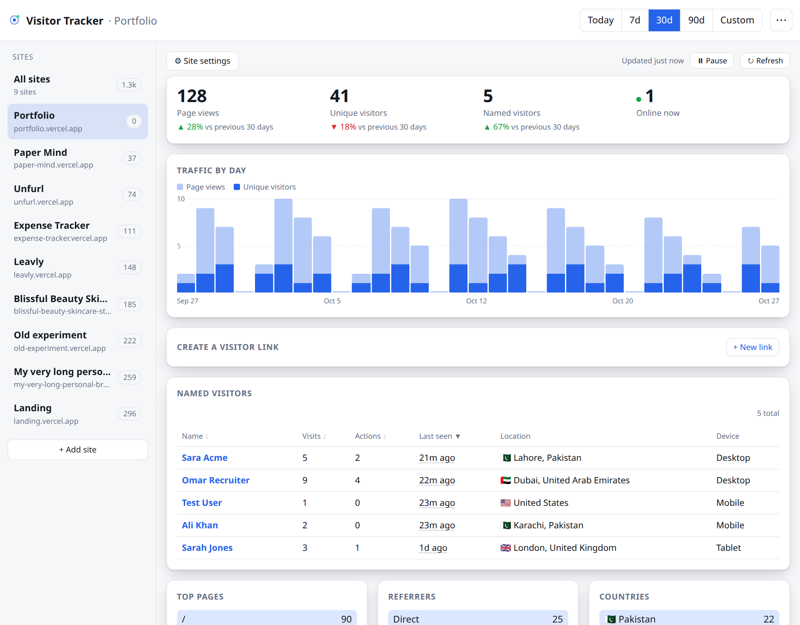
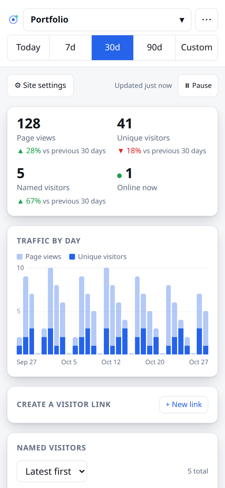

<h1 align="center">📡 Visitor Tracker</h1>

<p align="center">
  <b>Know who is looking at your work.</b><br/>
  A small self-hosted tracker with a dashboard. One deployment watches all your sites, and a link like <code>?ref=Sara-Acme</code> tells you when a named person opens it.
</p>

<p align="center">
  <a href="https://github.com/ahmad-zaman123/visitor-tracker/actions/workflows/test.yml"></a>
  <a href="https://visitor-tracker-app.vercel.app"></a>
  
  
  
  
  
  <a href="LICENSE"></a>
</p>

<p align="center">
  <a href="https://visitor-tracker-app.vercel.app"><b>Live demo → visitor-tracker-app.vercel.app</b></a><br/>
  <sub>Click <b>Try the demo</b> on the sign-in page to look around with sample data. No password needed, and it's read-only.</sub>
</p>

<p align="center">
  <a href="#-quick-start">Quick start</a> ·
  <a href="#-how-it-works">How it works</a> ·
  <a href="#-features">Features</a> ·
  <a href="#-api">API</a> ·
  <a href="#-tests">Tests</a> ·
  <a href="#%EF%B8%8F-deployment">Deployment</a>
</p>

<p align="center">
  <picture>
    <source media="(prefers-color-scheme: dark)" srcset="docs/screenshots/overview-dark.png" />
    
  </picture>
</p>

---

## 🧭 What is Visitor Tracker?

A privacy-minded analytics tool for a handful of personal sites: a portfolio, a few side projects, a landing page. You paste one `<script>` tag into each site and watch the traffic from a single dashboard. It records page views, referrers, country and city, device and browser, and it can put a **name** to a visit when you share a personalised link, which is handy when you send your portfolio to a recruiter and want to know whether they opened it.

It runs free on **Vercel Hobby** and **Neon**, with no servers to look after and no third party seeing your visitors.

| 📥 Collect | 📊 Watch | 🔔 Know who |
|---|---|---|
| One snippet per site. Page views, downloads and email, phone and outbound clicks are logged on their own | Totals against the previous period, traffic by day, top pages, referrers, countries, devices and campaigns | `?ref=Sara-Acme` names the visitor, and their whole timeline is one tap away |

## 🚀 Quick start

**Prerequisites:** a [Vercel](https://vercel.com) account and a GitHub account. Both free tiers are enough.

1. Fork or push this repo to GitHub and import it in Vercel.
2. In the Vercel project go to **Storage → Create → Neon (Postgres)**. This sets `DATABASE_URL` for you.
3. Add the environment variables below, then deploy.
4. Open the project URL, sign in, and click **+ Add site**.
5. Paste the snippet it shows into your site's `<head>`:

```html
<script defer src="https://YOUR-TRACKER.vercel.app/t.js" data-site="SITE_ID"></script>
```

The tables are created automatically on first use, so there is no migration step.

<details>
<summary><b>🔧 Environment variables</b></summary>
<br/>

| Key | Required | Notes |
|---|---|---|
| `DATABASE_URL` | **yes** | Set by the Neon integration. |
| `ADMIN_PASSWORD` | **yes** | The dashboard password. Changing it signs everyone out. |
| `HASH_SALT` | **yes** | Any long random string. Salts the IP hash and signs sessions. |
| `CRON_SECRET` | recommended | Any long random string. Vercel sends it with the daily cleanup call, and the endpoint refuses requests without it. Without it, old visits are never deleted and the dashboard warns you. |
| `RETENTION_DAYS` | no | How long to keep events. Default 180, minimum 30. |
| `DEMO_MODE` | no | Set to `1` to show a **Try the demo** button on the sign-in page. See [Demo mode](#-demo-mode). |

</details>

<details>
<summary><b>📜 Scripts</b></summary>
<br/>

| Command | What it does |
|---|---|
| `npm test` | Unit tests and API tests against an in-memory Postgres |
| `npx vercel dev` | Run locally (needs `vercel link` and `vercel env pull` first) |

</details>

### Name a visitor

```text
https://yoursite.com/?ref=Sara-Acme          →  shows up as "Sara Acme", and is remembered on later visits
https://yoursite.com/?utm_source=linkedin&utm_campaign=job-oct   →  credited to that campaign
```

```js
tracker.identify('Sara');          // name someone from your own code
tracker.track('clicked-resume');   // log a custom event
```

## 🎮 Demo mode

**[Try it live →](https://visitor-tracker-app.vercel.app)** and click **Try the demo** on the sign-in page.

To offer the same on your own deployment, set `DEMO_MODE=1` and the sign-in page gets a **Try the demo** button. It opens the full dashboard with generated sample data (three made-up sites and a few named visitors), so anyone can click around without a password.

- It is **read-only**: adding, renaming and deleting sites, backups, exports and device management are blocked on the server, not just hidden.
- It never touches your database. The sample data is generated in memory, so your real visitors and sites are never exposed.
- Demo sessions last 2 hours and are signed separately from real ones, so they can't be used as an admin session. Switching `DEMO_MODE` off ends them at once.

## 🧩 How it works

```
 your site ── t.js ──▶ POST /api/collect ──▶ checks origin ──▶ drops bots ──▶ hashes the IP ──▶ Neon Postgres
                                                                                                      │
 you ── password or fingerprint ──▶ signed session (12 h, or 30 days) ──▶ /api/stats · /api/overview ◀┘
                                                                          dashboard (installable PWA)
```

| Step | What happens |
|---|---|
| **Snippet** | `t.js` stores a random visitor id in the browser, reads `?ref=` and the UTM tags, and sends the event with `sendBeacon`. It does nothing when Do Not Track is on. |
| **Collect** | `/api/collect` ignores hits from a domain other than the one registered for that site id, ignores bots and link previews, and stores a salted hash of the IP instead of the address. |
| **Query** | Every dashboard view is one or two round trips: `/api/overview` groups all sites in a single set of queries, and `/api/stats` runs its queries in parallel. |
| **Retention** | A daily Vercel Cron job calls `/api/cleanup`, which deletes events older than the retention window and old sign-in attempts. |

## ✨ Features

<table>
<tr>
<td width="50%" valign="top">

### 🏠 One dashboard for every site

An overview with totals against the previous period, the most downloaded site, the top campaign and recently named visitors, then a card per site with a sparkline. Sort by most views, most recent, biggest change or name, and switch between cards and a table.

### 👤 Named visitors

A personalised link puts a name on a visit. Tap the name to see their whole timeline: pages, downloads, clicks, location, device and the campaign they came from.

### 🖱️ Automatic click events

`clicked-email`, `clicked-phone`, `downloaded-<file>` and `outbound-<site>` are logged with no extra code. Skip a link with `data-track="off"`.

### 📣 Campaigns

Add `utm_source`, `utm_medium` or `utm_campaign` to a link. The visit, and the downloads and clicks that follow in the same tab, are credited to it.

</td>
<td width="50%" valign="top">

### 🔒 Private by design

No raw IPs are stored. Visitor ids are random and live in the visitor's own browser. Do Not Track is honoured, and the dashboard is `noindex`.

### 🔑 Sign in with a fingerprint

After the first password sign-in the dashboard offers to enable fingerprint or Face ID on that device, using **passkeys (WebAuthn)**, so the biometric never leaves the phone. Five wrong guesses from one address pause sign-in.

### 📱 Installable and phone friendly

Add it to your home screen and it opens in its own window. It has a bottom-sheet site switcher, pull to refresh, offline fallback to the last data it saw, and a back button that behaves.

### 🌗 Light and dark

Follows the system theme, with a manual toggle.

### 🎮 Try before you deploy

Optional read-only demo with sample data, for showing the dashboard to someone without sharing a password.

### 💾 Your data is yours

CSV export of one site's events, and a one-file JSON backup of everything.

</td>
</tr>
</table>

<p align="center">
  <picture>
    <source media="(prefers-color-scheme: dark)" srcset="docs/screenshots/dashboard-dark.png" />
    
  </picture>
</p>

<p align="center">
  <picture>
    <source media="(prefers-color-scheme: dark)" srcset="docs/screenshots/mobile-dark.png" />
    
  </picture>
</p>

## 🔌 API

The tracker endpoint is public. Everything else needs the signed session returned by `/api/login`, sent as `Authorization: Bearer <token>`.

| Area | Endpoints |
|---|---|
| **Collect** | `POST /api/collect` (public, CORS open, origin-checked) |
| **Sign in** | `GET`, `POST /api/login` (`GET` says whether the demo is on), `POST /api/passkey?action=auth-options` and `auth-verify` |
| **Devices** | `GET`, `DELETE /api/passkey`, `POST /api/passkey?action=reg-options` and `reg-verify` |
| **Sites** | `GET`, `POST`, `PATCH`, `DELETE /api/sites` |
| **Stats** | `GET /api/overview?days=30`, `GET /api/stats?site=<id>&days=30`, `GET /api/visitor?site=<id>&name=<name>` |
| **Data** | `GET /api/export?kind=csv&site=<id>`, `GET /api/export?kind=backup`, `GET /api/settings` |
| **Maintenance** | `GET /api/cleanup` (Vercel Cron, or a signed-in session) |

## 🧪 Tests

```bash
npm install
npm test
```

27 tests run on Node's built-in runner. The API tests call the real handlers against an **in-memory Postgres** ([PGlite](https://pglite.dev)), swapped in for the Neon driver with a module resolve hook, so no database or network is needed.

| Covers | Examples |
|---|---|
| **Sign-in and sessions** | wrong password refused, five wrong guesses lock an address, tampered or expired tokens rejected, a changed password signs everyone out |
| **Collect** | IP stored only as a hash, bots dropped, unknown sites and foreign origins ignored, `sendBeacon` text bodies and subdomains accepted |
| **Dashboard queries** | totals, named visitors, campaigns, top page and source per site |
| **Retention** | cleanup removes only events past the window, and deleting a site removes its events |
| **Demo mode** | off by default, sample data only, writes and exports refused, forged or expired demo tokens rejected |
| **Helpers** | user-agent parsing, domain cleaning, retention floor, constant-time comparisons |

CI runs the same suite on every push and pull request.

## 🛠️ Tech stack

| Layer | Tech |
|---|---|
| **Backend** | Vercel Functions (Node, ESM), Vercel Cron |
| **Database** | Postgres on Neon, via `@neondatabase/serverless` |
| **Auth** | HMAC-signed sessions, WebAuthn passkeys (`@simplewebauthn/server`) |
| **Frontend** | One dependency-free HTML file: vanilla JS and CSS, SVG charts, a service worker and a web manifest |
| **Tests** | `node:test` and PGlite |
| **Deployment** | Vercel + Neon, both on free tiers |

## 🗂️ Project structure

```
visitor-tracker/
├── backend/                  server code (Vercel Functions)
│   ├── collect.js            public tracker endpoint
│   ├── login.js              password sign-in with rate limiting
│   ├── passkey.js            fingerprint / Face ID sign-in and device list
│   ├── sites.js              add, rename, delete sites
│   ├── overview.js           every site in one set of queries
│   ├── stats.js              one site: totals, charts, breakdowns
│   ├── visitor.js            one named visitor's timeline
│   ├── export.js             CSV and JSON backup
│   ├── settings.js           retention and cleanup status
│   ├── cleanup.js            daily retention job
│   ├── _lib.js               database, sessions, hashing, user-agent parsing
│   ├── _demo.js              sample data for the read-only demo
│   └── schema.sql            the tables, for reference
├── frontend/                 everything the browser loads
│   ├── index.html            the dashboard
│   ├── t.js                  the tracker snippet
│   ├── sw.js                 offline app shell
│   └── manifest.webmanifest, icons
├── api/                      one-line entry points into backend/ (Vercel only runs functions from /api)
├── tests/                    unit and API tests
└── vercel.json               output directory, headers and the cron schedule
```

## ☁️ Deployment

- **Vercel** serves the dashboard from `frontend/` and runs the functions in `api/`, which just re-export the handlers in `backend/`. `vercel.json` sets the cache headers and the daily cron at 03:00 UTC.
- **Neon** holds the data. The tables are created on first use.
- **Install as an app:** in Chrome or Edge use the install icon in the address bar, on Android choose "Add to Home screen", on iPhone use Share then "Add to Home Screen".
- **Backups:** the Account section of the dashboard downloads one JSON file with every site and event, and reminds you when it has been a while.

## 📄 License

[MIT](LICENSE) © 2026 Ahmad Zaman
